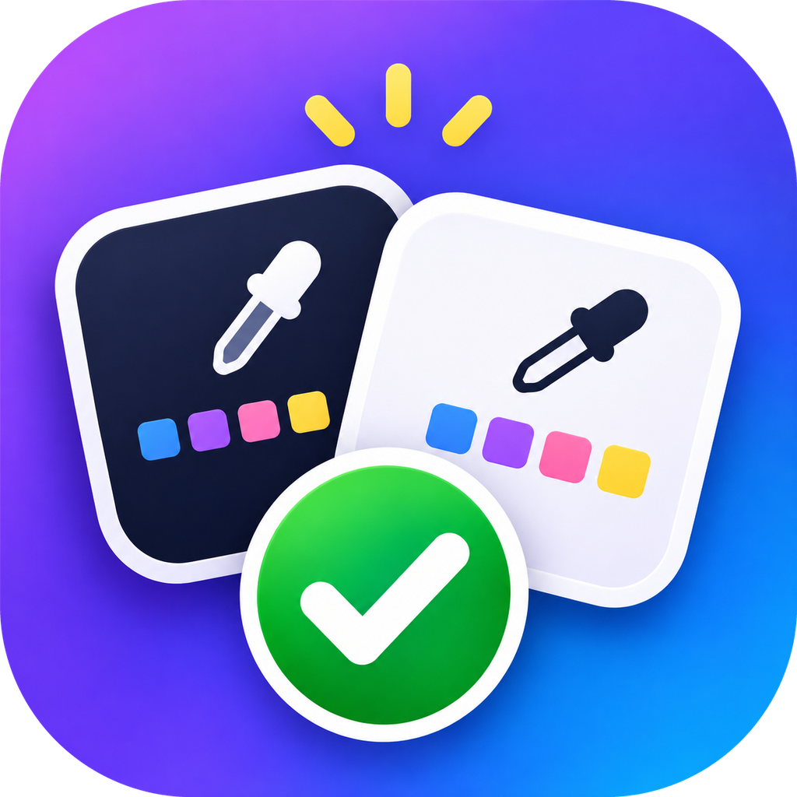
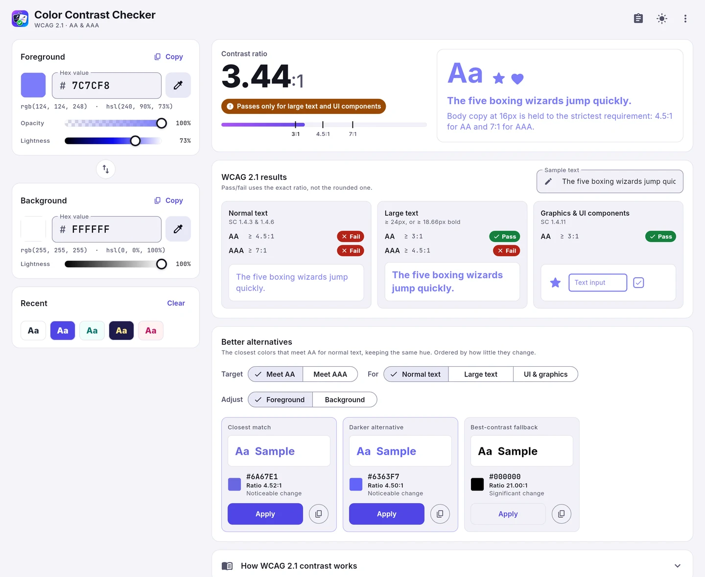

<p align="center">
  
</p>

<h1 align="center">Color Contrast Checker</h1>

<p align="center">
  A WCAG 2.1 color contrast checker for Windows, macOS and Linux, with an eyedropper that works anywhere on your screen.<br>
  <a href="https://color-contrast.joemazzone.net">color-contrast.joemazzone.net</a>
</p>



## Features

- WCAG 2.1 results for normal text, large text, and graphics and UI components at AA and AAA, with live previews.
- A system-wide eyedropper (<kbd>Ctrl</kbd>+<kbd>1</kbd> / <kbd>⌘</kbd><kbd>1</kbd> for the foreground, <kbd>2</kbd> for the background):
  - **macOS:** `NSColorSampler`, the system loupe. No Screen Recording permission needed.
  - **Windows:** a native overlay showing a frozen screenshot with a magnifier loupe.
  - **Linux:** the XDG desktop portal `PickColor` (GNOME, KDE, Wayland and X11), with an X11 overlay as a fallback.
- Better alternatives: the closest passing colors that keep the hue, found in OKLCH and HSL, verified after 8-bit rounding and ordered by perceptual distance. A black or white fallback is always included.
- Opacity blending (the foreground is composited over the background like a browser does) and an HSL lightness slider.
- Accepts hex, `rgb()`, `hsl()` and CSS color names. Copies HEX, RGB, HSL or a Markdown report.
- Recent pairs, light and dark themes, and keyboard shortcuts. Works fully offline.

Ratios are truncated to two decimals, never rounded up, so 4.499:1 reads 4.49 and fails. Pass and fail always use the exact value.

## Repository layout

| Path | What it is |
| --- | --- |
| `app/` | The Flutter desktop app |
| `packages/wcag_contrast/` | Pure Dart: color parsing, WCAG math, OKLab/OKLCH/HSL, the alternatives engine |
| `packages/desktop_eyedropper/` | Flutter plugin: native screen color picking (Swift, C++/Win32, GTK + D-Bus portal) |
| `website/` | Static marketing site (plain HTML/CSS/JS), deployed to GitHub Pages |
| `branding/` | Icon source and `generate_icons.py`, which regenerates every platform icon |
| `codemagic.yaml` | macOS build, signing, notarization and release upload |
| `.github/workflows/` | CI, Windows/Linux releases, website deploy |

The Dart packages form a [pub workspace](https://dart.dev/tools/pub/workspaces), so one `flutter pub get` at the root resolves everything.

## Development

Requires Flutter 3.47 (stable).

```sh
flutter pub get

# Tests
(cd packages/wcag_contrast && dart test)
(cd packages/desktop_eyedropper && flutter test)
(cd app && flutter test --exclude-tags screenshots)

# Run the app
cd app && flutter run -d linux   # or -d macos / -d windows
```

Linux builds need `clang cmake ninja-build pkg-config libgtk-3-dev`.

Regenerate the website screenshots from the real UI (golden tests):

```sh
cd app && flutter test --update-goldens --tags screenshots
```

Regenerate the icons after changing `branding/icon-source.png`:

```sh
python3 branding/generate_icons.py
```

## Releasing

1. Bump `version:` in `app/pubspec.yaml`.
2. Tag and push: `git tag v1.0.0 && git push origin v1.0.0`.
3. GitHub Actions builds the Windows installer, portable zip and (once configured) MSIX, plus the Linux AppImage, `.deb` and `.tar.gz`, and attaches them to the release.
4. Codemagic's `macos-release` workflow builds, signs, notarizes and uploads `ColorContrastChecker-macOS.dmg` to the same release.

The website links to `releases/latest/download/<file>`, so download links never need updating.

## License

[MIT](LICENSE) © Joe Mazzone
